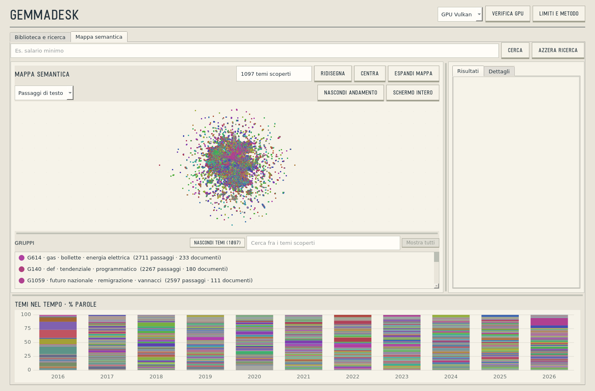
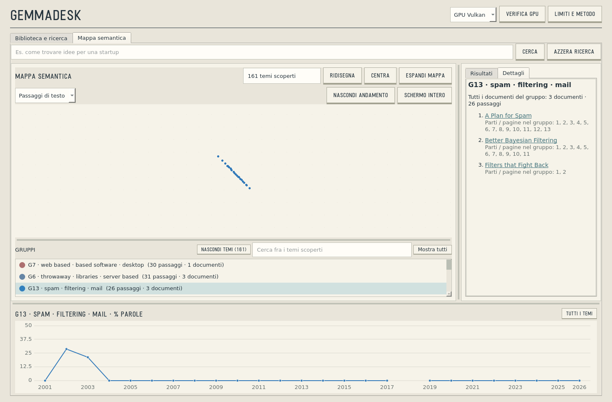
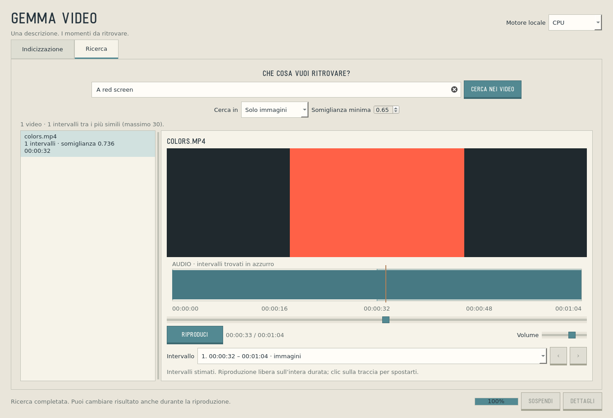

# GemmaDesk

Local semantic search with [EmbeddingGemma 2](https://huggingface.co/ggml-org/embeddinggemma-2-GGUF), running on CPU or Vulkan GPU.

- **GemmaDesk:** search documents, explore semantic maps and follow topics over time.
- **GemmaVideo:** search audio and frames with text, then play the matching moments.



## Run

Linux x86_64 · Debian 13 · Python 3.11+

```bash
git clone https://github.com/GarauGarau/GemmaDesk.git
cd GemmaDesk
sudo apt install python3-venv python3-dev build-essential pkg-config \
  libmupdf-dev zlib1g-dev ffmpeg libvulkan1 mesa-vulkan-drivers \
  libxcb-cursor0 libegl1 libxkbcommon-x11-0
./scripts/setup.sh
source .venv/bin/activate
./Avvia-GemmaDesk.sh
./Avvia-GemmaVideo.sh
```

Setup downloads the Q8_0 model and llama.cpp b11658, then builds both apps.
Add files, index them, then search.

## Examples

```bash
python scripts/documents.py index --source examples/documents --data data/demo
python scripts/documents.py search --data data/demo --query "Store solar energy for the night"
./Avvia-GemmaDesk.sh --data data/demo --corpus examples/documents --collection "My documents"

python examples/make_video.py
./Avvia-GemmaVideo.sh --source examples/generated
```

Replace `examples/documents` with your own folder of TXT, Markdown, PDF, DOCX or images. Add `--backend vulkan` for GPU indexing. Optional `filename.txt.json` metadata: `{"title":"My text","date":"2024-06-12"}`.

 

## Benchmarks

AMD Ryzen AI 9 HX PRO 370 · Radeon 890M · Q8_0 · 8 CPU threads. Warm medians: 10 runs; search: 5 queries × 5 runs. Model loading excluded.

| Task | CPU | Vulkan |
|---|---:|---:|
| Embed 1,024 tokens | 635 ms | **137 ms** |
| Embed 4,096 tokens | 4.14 s | **0.72 s** |
| Embed 20 s of audio | 752 ms | **202 ms** |
| Embed a 672 × 420 frame | 722 ms | **199 ms** |
| Index 64 s of video | 20.39 s | **9.55 s** |
| Search 248 text vectors | 23.9 ms | **16.4 ms** |
| Search 7,231 audio/frame vectors | 43.1 ms | **39.0 ms** |

**7,491 tokens/s** at 1,024 tokens; video indexing **6.7× real time**. [Measurements](bench/results/ryzen-ai-370.json).

```bash
python bench/run.py --backend both --repeats 10
```
